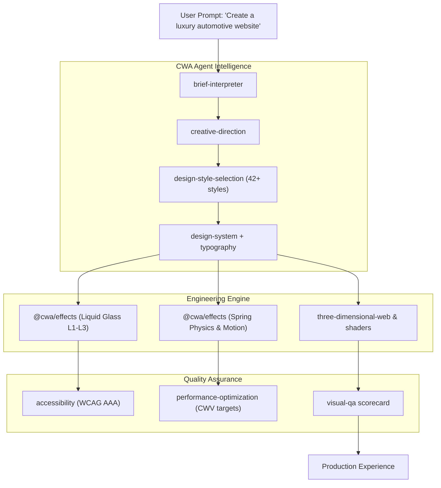

# Creative Web Architect

[](https://github.com/creative-web-architect/creative-web-architect/actions/workflows/ci.yml)
[](LICENSE)
[](https://pnpm.io/)
[](https://www.typescriptlang.org/)
[](https://nodejs.org/)

> **Autonomous AI Design & Creative Development Agent Toolkit.**  
> Transform one-sentence prompts like *"Create a luxury automotive website"* into distinctive, production-grade, accessible, and high-performance websites.

---

## Overview

**Creative Web Architect (CWA)** is a model-agnostic, open-source creative engineering system designed for developers and non-developers. Rather than pretending to be a standalone language model, CWA equips your existing AI coding environments (Cursor, Claude Code, Antigravity, Gemini CLI, Windsurf, GitHub Copilot) with autonomous design intelligence.

CWA bridges the gap between basic boilerplate code and award-winning digital experiences by unifying 15 creative disciplines:

1. **Creative Director** — Visual storytelling, emotional resonance, brand archetype
2. **Digital Art Director** — Cinematic aesthetic direction and layout harmony
3. **Brand Identity Designer** — Bespoke colorways, micro-pigments, and styling tokens
4. **UI/UX Designer** — Ergonomic information hierarchy and user flows
5. **Typography Specialist** — Optical sizing, modular fluid scales, and kinetic type
6. **Design System Architect** — Semantic tokens for light/dark and glassmorphism
7. **Frontend Engineer** — Robust, modern TypeScript, CSS, and component architectures
8. **Motion Designer** — Spring physics, gestures, cursor magnetism, and stagger delays
9. **3D / WebGL Engineer** — Three.js choreography, GLTF compression, and canvas shaders
10. **Interactive Experience Designer** — Tactile haptics and multi-sensory feedback
11. **Web Performance Engineer** — Core Web Vitals (LCP ≤ 2.5s, INP ≤ 200ms, CLS ≤ 0.1)
12. **Accessibility Engineer** — WCAG AAA contrast, keyboard traps, and reduced-motion
13. **Visual QA Specialist** — Systematic design review and regression scoring
14. **Open-Source Tooling Engineer** — Frictionless CLI (`cwa`) and multi-environment detection
15. **Technical Documentation Writer** — Standardized specifications and actionable guides

---

## Architecture



---

## Quick Start: Initialize Any Project in Seconds

When you clone this repository, you can instantly inject all **36 Agent Skills**, **27 Learned Architectural Techniques**, and the **Master Anti-Generic Directives** into **any target folder** on your computer with a single terminal command—**no manual copying or pasting required**:

### Step 1: Clone & Build Repository
```bash
git clone https://github.com/Avestroxel/creative-web-architect.git
cd creative-web-architect
pnpm install
pnpm build
```

### Step 2: Initialize Your Target Project Directory
Run `cwa init` followed by the path of the folder you want to power up:

**On Windows (PowerShell / CMD):**
```powershell
.\cwa.cmd init "C:\Path\To\YourProject"
```

**On macOS / Linux:**
```bash
./cwa init /path/to/your-project
```

**Using pnpm:**
```bash
pnpm cwa init "C:\Path\To\YourProject"
```

*(Note: If you run `.\cwa.cmd init` or `pnpm cwa init` without a path, it will initialize the current directory.)*

### Step 3: What Gets Automatically Injected
- `.agents/skills/` and `./skills/` — All 36 specialized Agent Skills
- `knowledge/` and `.agents/knowledge/` — 27 learned architectural techniques from award-winning sites
- `AGENTS.md` & `GEMINI.md` — Strict Anti-Generic Mandate, No-Glow Architectural Policy, and technique inventory
- `cwa.config.json` — Environment auto-detection configuration

### Step 4: Open and Prompt Your AI Agent
Open your target folder in **Antigravity**, **Cursor**, **Claude Code**, or **Gemini CLI**. Your agent will immediately recognize the skills, reference the 27 techniques, and build bespoke, award-winning interfaces from simple prompts.

---

### Verify Environment Health
Run the diagnostic suite anytime:
```bash
.\cwa.cmd doctor
# or
pnpm cwa doctor
```

---

## Supported AI Coding Environments

| Environment | Supported Format | Auto-Detected Config Location |
| :--- | :--- | :--- |
| **Cursor** | `.cursorrules` & `.cursor/skills` | `.cursor/` or `.cursorrules` |
| **Antigravity** | Agent Skills (`SKILL.md`) | `.agents/skills` or `AGENTS.md` |
| **Claude Code** | Agent Skills (`SKILL.md`) | `.claude/skills` or `CLAUDE.md` |
| **Gemini CLI** | Agent Skills (`SKILL.md`) | `.gemini/skills` or `GEMINI.md` |
| **GitHub Copilot** | Custom Instructions | `.github/copilot-instructions.md` |
| **Windsurf / VS Code** | System Markdown Prompting | `.windsurf/` or `.vscode/` |

---

## Workspace Packages

This monorepo is organized using **pnpm workspaces**:

- **[`packages/core`](./packages/core)**: Core skill discovery engine, configuration management (`cwa.config.json`), design tokens, motion tokens (`MOTION_DURATIONS`, `REFINED_EASINGS`, `MOTION_PROFILES`), and the No-Glow architectural visual policy.
- **[`packages/cli`](./packages/cli)**: Command-line interface (`cwa init`, `install`, `update`, `doctor`, `list`, `uninstall`).
- **[`packages/effects`](./packages/effects)**: React component library providing **Liquid Glass** surfaces (Button, Card, Navbar, Dock, Modal, Tabs, Switch, Tooltip), spring motion physics, and interactive motion components (MagneticButton, DirectionalHoverButton, SlidingTextButton, MorphingStateButton, RefinedSwitch, SegmentedControl, RefinedAccordion, ScrollReveal, PinnedStorySection).
- **[`examples/motion-laboratory`](./examples/motion-laboratory)**: Interactive laboratory demonstrating refined motion design, spring micro-interactions, subtle buttons, and the No-Glow architectural visual policy.
- **[`examples/showcase`](./examples/showcase)**: Interactive showcase gallery and live Liquid Glass playground.
- **[`templates/luxury-automotive`](./templates/luxury-automotive)**: *Aether Apex* — Showcase luxury electric Grand Tourer with rotatable 3D canvas wireframe, live telemetry, colorway switcher, and Web Audio API electric propulsion acoustic simulator.
- **[`templates/modern-dashboard`](./templates/modern-dashboard)**: *Nebula.OS* — Real-time distributed GPU cluster telemetry dashboard with live Canvas throughput graphs, floating Liquid Glass dock, and `Cmd+K` command palette.
- **[`templates/creative-portfolio`](./templates/creative-portfolio)**: *Kaelen Voss Studio* — Creative technologist portfolio with spring-smoothed custom cursor, filterable archive grid, and performance-driven case study modals.

---

## Critical Design Rule: Architectural No-Glow Policy

By default, every project created or upgraded with Creative Web Architect enforces **architectural restraint**:
- **Zero Cheap Neon Glows**: Eliminates decorative purple/blue ambient halos, glowing borders on every card, and childish bloom.
- **Matte & Layered Materials**: Obsidian (`#0C0D12`), charcoal (`#14161F`), warm off-white typography (`#F1F5F9`), and champagne hairline accents.
- **Subtle Physical Believability**: Restrained 20px frosted blur, 0.5px specular highlights, and spring-damped micro-interactions.
- *Artistic Flexibility Preserved*: Vibrant gradients, neon accents, and cyberpunk lighting remain supported when explicitly requested by brand or user instruction.

---

## The 36 Agent Skills Catalog

Every skill is structured as a self-contained directory containing a standardized `SKILL.md` file with YAML frontmatter:

| Skill | Category | Primary Focus |
| :--- | :--- | :--- |
| `knowledge-ingestion` | Knowledge | Ingests reference prompts, extracts techniques, deduplicates, and indexes |
| `no-excessive-glow-policy` | Policy | Permanent architectural lighting & material policy eliminating cheap AI tropes |
| `advanced-scroll-animation`| Motion | Pinned storytelling chapters, clip-path reveals, bidirectional scrubbing |
| `premium-button-interactions`| Motion | 18 tactile button patterns: magnetic, directional hover, morphing states |
| `toggle-and-switch-motion` | Micro | Spring-damped switches, fluid segmented pills, zero-thrash accordions |
| `hover-interaction-design` | Motion | Controlled 3D tilt (≤6°), directional overlays, cursor magnetic tracking |
| `page-transitions` | Motion | Seamless route transitions, shared elements, non-blocking navigation |
| `cinematic-motion` | Motion | Narrative rhythm, editorial choreography, spatial depth staging |
| `refined-liquid-glass` | Material | Physically believable frosted optics, 0.5px hairline edges, zero bloom |
| `premium-visual-direction` | Direction | Senior art direction standards, editorial typography, quiet luxury |
| `animation-performance` | Performance | 60 FPS frame budgeting, RAF scheduling, zero layout thrashing, cleanup |
| `motion-accessibility` | A11y | WCAG standards, `prefers-reduced-motion`, vestibular safety |
| `visual-motion-qa` | Quality | 15-step motion QA checklist: rapid clicks, frame drops, layout shifts |
| `brief-interpreter` | Intelligence | Deconstructs vague user prompts into structured design requirements |
| `creative-direction` | Intelligence | Formulates art direction, color moodboards, and narrative tension |
| `design-style-selection`| Design | 42+ curated aesthetics (Minimal, Brutalist, Cyber, Luxury, Bento, etc.) |
| `typography` | Design | Modular type scales, optical sizing, fluid `clamp()` formulas, RTL |
| `layout-composition` | Design | Asymmetric grids, bento layouts, container queries, visual rhythm |
| `design-system` | Design | Complete semantic token hierarchies (colors, spacing, elevation) |
| `liquid-glass` | Engineering | Multi-layer frosted glass surfaces, blur levels, specular highlights |
| `motion-design` | Engineering | Spring physics curves, micro-interactions, cursor magnetism, staggers |
| `scroll-storytelling` | Engineering | Pinned cinematic scroll sequences, scrubbed reveals, horizontal feeds |
| `three-dimensional-web`| 3D / WebGL | Three.js scenes, GLTF optimization, lighting, and camera orbits |
| `shaders-and-effects` | 3D / WebGL | GLSL fragment shaders, procedural noise, bloom, displacement |
| `accessibility` | Quality | WCAG AAA contrast, keyboard traps, ARIA roles, reduced motion |
| `performance-optimization`| Quality | Core Web Vitals targets: LCP ≤ 2.5s, INP ≤ 200ms, CLS ≤ 0.1 |
| `visual-qa` | Quality | Systematic design audits, scorecard reviews, regression tests |
| `responsive-design` | Quality | Mobile-first breakpoints, touch targets (≥44px), viewport scaling |
| `content-writing` | Creative | Editorial copy, high-impact headlines, UI microcopy |
| `image-art-direction` | Creative | Visual styling direction, photography filters, procedural SVGs |
| `website-redesign` | Strategy | Incremental refactoring and aesthetic elevation of legacy sites |
| `ecommerce-design` | Domain | High-conversion product showcases, quick-views, micro-checkouts |
| `dashboard-design` | Domain | Telemetry layouts, live data streaming, dark-mode ergonomics |
| `portfolio-design` | Domain | Creative showcases, interactive case studies, contact drawers |
| `cinematic-product-pages`| Domain | Sticky feature reveals, exploded views, technical specifications |
| `project-delivery` | Production | Production build audits, bundle optimization, security checks |

---

## Liquid Glass Specification

Liquid Glass in CWA is designed as an architectural material system spanning three tiers:

- **Level 1 (Standard CSS)**: Hardware-accelerated `backdrop-filter: blur(12px-40px) saturate(180%)`, translucent borders with specular contrast, and high-depth box shadows.
- **Level 2 (Interactive Specular Highlights)**: Dynamic radial gradient highlights that follow mouse/touch coordinates, simulating directional light refraction across glass surfaces.
- **Level 3 (Advanced Fluid Dynamics)**: WebGL displacement maps, optical chromatic aberration, and canvas refractions with fallback to Level 1.

All Liquid Glass components automatically respect user motion preferences and fall back gracefully on devices without `backdrop-filter` support.

---

## Core Web Vitals & Performance Targets

Every design generated by Creative Web Architect is held to strict performance standards:

| Metric | Target | Method |
| :--- | :--- | :--- |
| **LCP (Largest Contentful Paint)** | `≤ 2.5s` | Critical CSS inlining, font-display: swap, responsive images |
| **INP (Interaction to Next Paint)** | `≤ 200ms` | CSS transforms for animations, debounced event listeners |
| **CLS (Cumulative Layout Shift)** | `≤ 0.1` | Explicit aspect ratios on media, reserve layout space |
| **Frame Rate** | `60 FPS` | GPU composited properties (`transform`, `opacity`), RAF loops |

---

## Development & Testing

```bash
# Clone the repository
git clone https://github.com/Avestroxel/creative-web-architect.git
cd creative-web-architect

# Install dependencies across all workspaces
pnpm install

# Build all packages (core, cli, effects)
pnpm build

# Run Vitest test suite
pnpm test

# Run CLI diagnostic
pnpm doctor

# Launch the official product website locally
cd examples/showcase && pnpm dev
```

---

## Author & Copyright

**Created by Anas Hashim.**

**Copyright © 2026 Anas Hashim. All rights reserved.**

---

## License & Open-Source Redistribution

Creative Web Architect is open-source software distributed under the terms of the **[MIT License](./LICENSE)**.  

Under the MIT License:
- **Permission is granted**, free of charge, to any person obtaining a copy of this software and associated documentation files, to deal in the Software without restriction, including without limitation the rights to use, copy, modify, merge, publish, distribute, sublicense, and/or sell copies of the Software.
- The above copyright notice (`Copyright © 2026 Anas Hashim. All rights reserved.`) and this permission notice shall be included in all copies or substantial portions of the Software.

Contributions, feedback, and skill extensions are welcomed via issues and pull requests on the official repository:  
**[https://github.com/Avestroxel/creative-web-architect](https://github.com/Avestroxel/creative-web-architect)**

